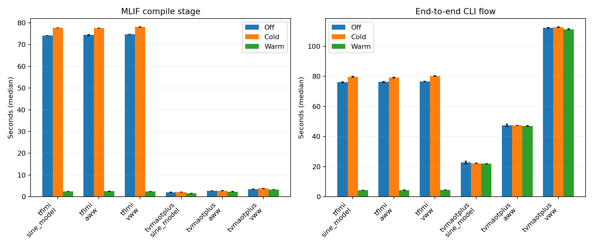
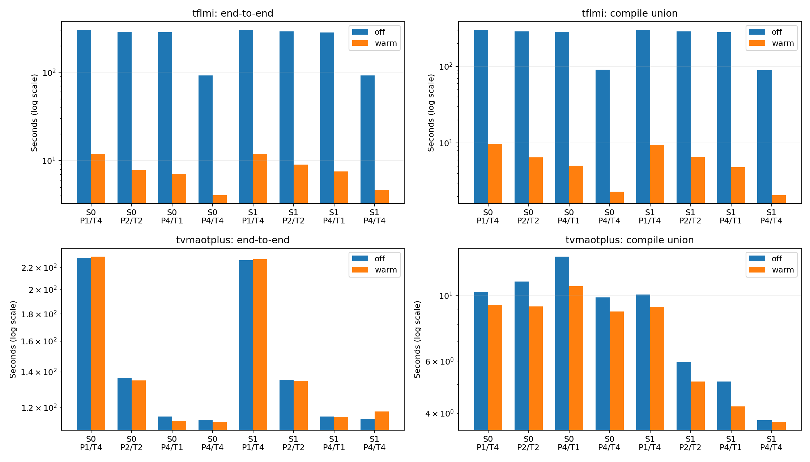

# MLIF ccache benchmarks: October 30 and November 2, 2026

85 successful measurements; 2 failed attempts retained for provenance.

## Findings

**tflmi:** warm-cache compile speedup across the three models was 29.11–30.01x; end-to-end speedup was 16.87–17.49x. Most of the uncached compilation is the common TFLM runtime.

**tvmaotplus:** warm-cache compile speedup across the three models was 1.07–1.28x; end-to-end speedup was 1.01–1.04x. The TVM end-to-end differences are small relative to normal timing variation; two repeats do not establish a reliable small improvement.

**Cache state changes the useful allocation of a four-job compile budget.** For TFLMI, four cold runs with one make job each took 323.57s (403 misses), versus 98.81s (114 misses) for one run at a time with four make jobs. With populated caches those allocations took 7.16s and 12.10s, respectively. These stage-mode comparisons have different BUILD limits, but TFLMI's BUILD time is very short; the compile interval and CPU measurements in the tables expose the difference directly.

**Scheduling guidance:** budget backend workers and compiler jobs separately. Empty shared caches can benefit from warming common runtime objects before launching consumers; warm caches often benefit from more concurrent runs. Group only compatible compiler/flags/runtime families. Run indices are normalized by this feature; it is cache availability during execution that makes scheduling order significant. The measured parallelism settings are single samples, not a proven universal optimum.

**Compile overlap is not the same as end-to-end speedup.** For TVMAOT+ P=2/T=2, stage mode changed compile union from 11.12s to 5.95s, while wall time changed only from 136.19s to 135.25s. The compile sums stayed similar: the stage barrier aligned the compilations in time.

The final audit verified 85 samples and 232 model runs, their report rows, saved ELF hashes, cache accounting and independently recompiled resnet object variants. See `validation.json`. Source revisions and local dependency changes are listed in `dependencies.json`.

The original 70-case matrix is complete. The extra scheduling study was stopped after 15 completed optional samples; 5 optional cases remain unmeasured. The interrupted TVM warm sample is excluded. TVM grouped/interleaved ordering was not measured. The missing names are recorded in `validation.json`.

## Measurement method

Each sample starts a new CLI process and fresh run directories, completes LOAD, BUILD, COMPILE and RUN, and requires successful report rows. The target is host_x86. TVM/BLAS internal threads are held at one. The three complexity workloads are sine_model, aww and vww. Four-run parallel batches add resnet. These are default backend builds without autotuning; results do not generalize to every model or target.

`off` disables ccache. `cold` starts an empty isolated session cache; later runs in that sample may share it. `warm` copies a populated cache before timing, then uses fresh directories. Cache copying is excluded from the timed CLI flow. Kernel page caches and dependency installations are not flushed: cold means ccache-cold, not machine-cold. Complexity samples have two repeats; parallelism and ordering are exploratory single samples.

End-to-end wall time includes process startup, backend generation, MLIF configuration, compilation, linking, artifact export and execution. Compile **sum** accumulates each run's elapsed compile-stage interval and can exceed wall time; it is not CPU time. Compile **union** counts time with at least one active compile stage, without double-counting overlaps. Compile **span** also includes gaps between the first and last compile. COMPILE includes configuration, linking and artifact generation, not just compiler subprocesses. BUILD is backend model/code generation. All times below are seconds.

The run resumed after Friday's interruption. Samples span two days on a shared 36-logical-CPU host, using ccache 3.7.7, GCC 9.4.0 and CMake 3.24.4. Load and child-process CPU time are recorded in the raw JSONL. Small timing differences and closely ranked configurations should not be treated as significant.

## Increasing model complexity

Medians across repeats. Speedup compares ccache off with warm ccache. Plot whiskers show the observed min–max range, not a confidence interval.

| Backend | Model | n off/cold/warm | Compile off | Compile cold | Compile warm | Wall off | Wall cold | Wall warm | Compile speedup | Wall speedup | Warm total hits/misses |
| --- | --- | --- | --- | --- | --- | --- | --- | --- | --- | --- | --- |
| tflmi | sine_model | 2/2/2 | 74.17 | 77.67 | 2.47 | 76.08 | 79.69 | 4.35 | 30.01x | 17.49x | 222/0 |
| tflmi | aww | 2/2/2 | 74.38 | 77.56 | 2.56 | 76.27 | 79.18 | 4.46 | 29.11x | 17.09x | 222/0 |
| tflmi | vww | 2/2/2 | 74.71 | 78.05 | 2.49 | 76.62 | 80.23 | 4.54 | 29.97x | 16.87x | 222/0 |
| tvmaotplus | sine_model | 2/2/2 | 2.05 | 2.19 | 1.61 | 22.83 | 22.27 | 21.92 | 1.28x | 1.04x | 35/1 |
| tvmaotplus | aww | 2/2/2 | 2.68 | 2.81 | 2.37 | 47.43 | 47.40 | 47.02 | 1.13x | 1.01x | 34/2 |
| tvmaotplus | vww | 2/2/2 | 3.49 | 3.83 | 3.28 | 112.30 | 112.61 | 111.17 | 1.07x | 1.01x | 34/2 |



## Four-run parallel batches

Each batch contains sine_model, aww, vww and resnet in that order. P is `--parallel`; T is `mlif.num_threads`; S is `runs_per_stage`. P×T is a rough peak make-job budget, not a limit on backend threads or all process activity.

| Backend | S | P | T | Wall off | Wall warm | Compile sum off | Compile sum warm | Compile union off | Compile union warm | Wall speedup | Warm hits/misses |
| --- | --- | --- | --- | --- | --- | --- | --- | --- | --- | --- | --- |
| tflmi | 0 | 1 | 4 | 300.25 | 11.98 | 297.49 | 9.63 | 297.49 | 9.63 | 25.07x | 444/0 |
| tflmi | 0 | 2 | 2 | 288.56 | 7.81 | 572.84 | 12.59 | 286.78 | 6.46 | 36.96x | 444/0 |
| tflmi | 0 | 4 | 1 | 285.81 | 7.04 | 1134.78 | 19.22 | 284.40 | 5.01 | 40.60x | 444/0 |
| tflmi | 0 | 4 | 4 | 92.12 | 4.04 | 358.75 | 8.69 | 90.33 | 2.30 | 22.79x | 444/0 |
| tflmi | 1 | 1 | 4 | 302.26 | 11.90 | 299.99 | 9.47 | 299.99 | 9.47 | 25.40x | 444/0 |
| tflmi | 1 | 2 | 2 | 289.79 | 8.99 | 573.64 | 12.73 | 286.98 | 6.52 | 32.25x | 444/0 |
| tflmi | 1 | 4 | 1 | 281.87 | 7.57 | 1114.73 | 19.08 | 279.40 | 4.84 | 37.24x | 444/0 |
| tflmi | 1 | 4 | 4 | 92.06 | 4.65 | 356.39 | 8.16 | 89.57 | 2.06 | 19.80x | 444/0 |
| tvmaotplus | 0 | 1 | 4 | 229.62 | 230.72 | 10.26 | 9.28 | 10.26 | 9.28 | 1.00x | 69/3 |
| tvmaotplus | 0 | 2 | 2 | 136.19 | 134.79 | 11.12 | 9.18 | 11.12 | 9.18 | 1.01x | 68/4 |
| tvmaotplus | 0 | 4 | 1 | 115.24 | 113.12 | 14.36 | 10.72 | 13.52 | 10.72 | 1.02x | 69/3 |
| tvmaotplus | 0 | 4 | 4 | 113.62 | 112.57 | 9.83 | 8.81 | 9.83 | 8.81 | 1.01x | 69/3 |
| tvmaotplus | 1 | 1 | 4 | 227.17 | 228.00 | 10.08 | 9.14 | 10.08 | 9.14 | 1.00x | 69/3 |
| tvmaotplus | 1 | 2 | 2 | 135.25 | 134.60 | 10.99 | 9.69 | 5.95 | 5.11 | 1.00x | 68/4 |
| tvmaotplus | 1 | 4 | 1 | 115.31 | 115.15 | 15.47 | 13.02 | 5.11 | 4.22 | 1.00x | 69/3 |
| tvmaotplus | 1 | 4 | 4 | 114.24 | 117.80 | 11.22 | 10.94 | 3.79 | 3.73 | 0.97x | 69/3 |



### CPU cost of the parallelism settings

CPU is user plus system time for the timed CLI process and its waited-for descendants, in core-seconds. Average cores = CPU / wall time. These values help distinguish lower latency from lower total CPU cost; peak memory was not measured.

| Backend | S | P/T | CPU off | CPU warm | Average cores off | Average cores warm |
| --- | --- | --- | --- | --- | --- | --- |
| tflmi | 0 | 1/4 | 1114.33 | 20.99 | 3.71 | 1.75 |
| tflmi | 0 | 2/2 | 1117.85 | 20.35 | 3.87 | 2.61 |
| tflmi | 0 | 4/1 | 1123.45 | 20.52 | 3.93 | 2.91 |
| tflmi | 0 | 4/4 | 1355.50 | 15.60 | 14.71 | 3.86 |
| tflmi | 1 | 1/4 | 1121.58 | 20.79 | 3.71 | 1.75 |
| tflmi | 1 | 2/2 | 1119.84 | 21.13 | 3.86 | 2.35 |
| tflmi | 1 | 4/1 | 1116.71 | 21.33 | 3.96 | 2.82 |
| tflmi | 1 | 4/4 | 1348.42 | 16.12 | 14.65 | 3.47 |
| tvmaotplus | 0 | 1/4 | 233.07 | 231.34 | 1.02 | 1.00 |
| tvmaotplus | 0 | 2/2 | 234.86 | 230.15 | 1.72 | 1.71 |
| tvmaotplus | 0 | 4/1 | 235.74 | 231.03 | 2.05 | 2.04 |
| tvmaotplus | 0 | 4/4 | 235.91 | 231.04 | 2.08 | 2.05 |
| tvmaotplus | 1 | 1/4 | 230.59 | 228.80 | 1.02 | 1.00 |
| tvmaotplus | 1 | 2/2 | 234.02 | 231.59 | 1.73 | 1.72 |
| tvmaotplus | 1 | 4/1 | 235.62 | 233.69 | 2.04 | 2.03 |
| tvmaotplus | 1 | 4/4 | 236.13 | 236.06 | 2.07 | 2.00 |

## Stage-specific worker limits and cold-cache scheduling

S=1, P=4; T is listed per row. BUILD=1/COMPILE=4/T=1 and BUILD=4/COMPILE=1/T=4 have the same four-job compile budget, allocated differently. Each cold sample starts empty; each warm sample starts from the same backend's four-model seed. Unspecified stages use P=4. The initial fully concurrent cold seed is shown as a reference.

| Backend | Limits | T | Cache | Wall | Build union | Compile sum | Compile union | CPU | Hits/misses |
| --- | --- | --- | --- | --- | --- | --- | --- | --- | --- |
| tflmi | S=0, P=4 | 4 | cold | 96.05 | 0.30 | 372.59 | 93.69 | 1408.03 | 42/402 |
| tvmaotplus | S=0, P=4 | 4 | cold | 114.07 | 108.43 | 9.61 | 9.61 | 234.16 | 45/27 |
| tflmi | BUILD=1,COMPILE=4,RUN=4 | 1 | cold | 323.57 | 0.19 | 1282.23 | 320.99 | 1284.08 | 41/403 |
| tflmi | BUILD=1,COMPILE=4,RUN=4 | 1 | warm | 7.16 | 0.17 | 18.95 | 4.81 | 20.82 | 444/0 |
| tflmi | BUILD=4,COMPILE=1,RUN=4 | 4 | cold | 98.81 | 0.46 | 96.22 | 96.22 | 322.49 | 330/114 |
| tflmi | BUILD=4,COMPILE=1,RUN=4 | 4 | warm | 12.10 | 0.44 | 9.16 | 9.16 | 20.70 | 444/0 |
| tflmi | BUILD=2,COMPILE=2,RUN=4 | 4 | cold | 92.16 | 0.27 | 178.75 | 89.73 | 645.68 | 232/212 |
| tflmi | BUILD=2,COMPILE=2,RUN=4 | 4 | warm | 6.78 | 0.30 | 8.76 | 4.42 | 19.18 | 444/0 |
| tvmaotplus | BUILD=1,COMPILE=4,RUN=4 | 1 | cold | 242.61 | 234.42 | 15.53 | 5.16 | 250.51 | 36/36 |
| tvmaotplus | BUILD=1,COMPILE=4,RUN=4 | 1 | warm | 233.12 | 226.16 | 12.86 | 4.19 | 239.76 | 69/3 |
| tvmaotplus | BUILD=4,COMPILE=1,RUN=4 | 4 | cold | 120.12 | 106.93 | 10.12 | 10.12 | 234.83 | 45/27 |
| tvmaotplus | BUILD=4,COMPILE=1,RUN=4 | 4 | warm | 119.32 | 107.14 | 9.15 | 9.15 | 232.30 | 69/3 |
| tvmaotplus | BUILD=2,COMPILE=2,RUN=4 | 4 | cold | 135.54 | 126.79 | 10.33 | 5.77 | 233.73 | 39/33 |

## Run ordering with an initially empty cache

S=0, T=4. Grouped = [sine_model, sine_model, aww, aww]; interleaved = [sine_model, aww, sine_model, aww]. Same multiset of runs. Concurrency, shared library reuse and the point at which a reusable object becomes available can all affect time and hit count. A single ordering comparison is evidence about these batches, not a universal scheduling rule.

| Backend | P | Order | Wall | Compile sum | Compile union | CPU | Hits/misses |
| --- | --- | --- | --- | --- | --- | --- | --- |
| tflmi | 1 | grouped | 90.72 | 88.80 | 88.80 | 314.13 | 332/112 |
| tflmi | 1 | interleaved | 90.89 | 88.38 | 88.38 | 312.62 | 332/112 |
| tflmi | 2 | grouped | 90.08 | 175.26 | 87.67 | 634.51 | 227/217 |
| tflmi | 2 | interleaved | 95.05 | 185.05 | 92.61 | 691.85 | 230/214 |

## Compiler identity

An isolated experiment copies GCC to two different absolute paths with the same basename. It then changes only mtime, then appends inert bytes to the ELF executable. `compiler_identity.json` contains cumulative counters; the table shows increments for each invocation.

| Check | Case | Hits | Misses |
| --- | --- | --- | --- |
| mtime | initial | 0 | 1 |
| mtime | different_absolute_path_same_name_and_metadata | 1 | 0 |
| mtime | identical_bytes_changed_mtime | 0 | 1 |
| mtime | changed_bytes | 0 | 1 |
| mtime | changed_bytes_same_size_and_mtime | 1 | 0 |
| mtime | identical_bytes_different_basename | 0 | 1 |
| content | initial | 0 | 1 |
| content | different_absolute_path_same_name_and_metadata | 1 | 0 |
| content | identical_bytes_changed_mtime | 1 | 0 |
| content | changed_bytes | 0 | 1 |
| content | changed_bytes_same_size_and_mtime | 0 | 1 |
| content | identical_bytes_different_basename | 0 | 1 |

The default is `mtime`: compiler size and modification time contribute to the cache key, along with the compiler name. Absolute path alone does not establish identity. `-c ccache.compiler_check=content` hashes executable bytes, avoiding misses from timestamp-only changes and detecting different bytes at the same path. This does not fingerprint an entire toolchain: separate GCC cc1 binaries, plugins or dynamic libraries can change independently. For those builds, use an immutable full-toolchain build ID (`string:<id>`) or `extra_files_to_hash` in ccache.conf. A shared version banner may hide local patches. [ccache 3.7.7 manual](https://ccache.dev/manual/3.7.7.html#_configuration_settings)

## Interpretation and scheduling guidance

TFLMI compiles a large common runtime, so model size alone need not increase MLIF compile time. Sharing those objects is valuable even between different models. TVMAOT+ generates model-specific C in BUILD; ccache only accelerates the later MLIF compilation. Its end-to-end benefit depends on how much of total time is spent in that stage and whether regenerated sources match.

Fresh TVM invocations can emit equivalent C in different declaration orders. The preserved `tvm_sine_regeneration.diff` shows this for the first sine_model cold/warm pair. That pair had 17 hits and one miss; all three initial sine_model binaries were byte-identical. A changed generated timestamp comment alone can fall back to a preprocessed hit, but reordered C can still require compilation. Repeating the same model therefore does not guarantee a fully warm compile.

Resnet also produced multiple ELF variants when pointer declarations changed order. The preserved `tvm_resnet_default_lib1.diff` records the generated source difference. The final audit independently recompiles that C unit for each recorded cache-enabled resnet ELF variant and compares its object bytes. See `resnet_cache_verification.json`.

Optimize batch wall time under a CPU and memory budget. For empty caches, completing a representative run from each genuinely compatible compiler/flags/runtime family before launching many consumers can reduce duplicate misses. That trades some initial concurrency for reuse; incompatible flags or compiler builds do not share those entries. ccache is not a dependency scheduler and should not be assumed to deduplicate simultaneous misses into a single compilation.

For mostly warm caches, more concurrent runs and fewer make threads per run can improve throughput under a fixed compile-job budget; configuration, linking and filesystem traffic eventually limit scaling. For CPU-heavy backend generation, use stage limits to control BUILD independently of COMPILE. Stage mode also introduces barriers: BUILD=1 serializes every model's backend generation before any MLIF compilation starts.

Measure both first-use and steady-state workloads, keep the run multiset and cache seeds fixed, and repeat promising configurations with alternating order. Tune separate cold and warm policies rather than seeking one universally optimal P/T setting. Session mode starts empty for each new session; workspace mode is useful when later experiments should reuse earlier results.

## Artifacts and reproduction

`measurements.jsonl` is append-only and includes failed attempts; `measurements.csv` contains the latest successful sample for each name. Per-run intervals, ELF SHA-256 digests, commands, cache counters, load and CPU usage are retained in JSONL. Raw commands and reports are under `/tmp/mlonmcu-ccache-bench-20261030`. `machine.json` records the original machine; `invocations.jsonl` records subsequent runner invocations. Incomplete interrupted directories are preserved.

```bash
venv/bin/python scripts/benchmark_ccache.py --home workspace_default \
  --raw /tmp/mlonmcu-ccache-bench-20261030 \
  --output benchmarks/ccache_2026-10-30 --suite all --repeats 2
venv/bin/python scripts/benchmark_ccache.py --home workspace_default \
  --raw /tmp/mlonmcu-ccache-bench-20261030 \
  --output benchmarks/ccache_2026-10-30 --suite scheduling
venv/bin/python scripts/benchmark_ccache_compiler_identity.py \
  --output benchmarks/ccache_2026-10-30/compiler_identity.json
venv/bin/python scripts/verify_ccache_benchmarks.py benchmarks/ccache_2026-10-30 --allow-partial
venv/bin/python scripts/summarize_ccache_benchmarks.py benchmarks/ccache_2026-10-30
```

Generated at 2026-11-02T07:41:42.449592+00:00
