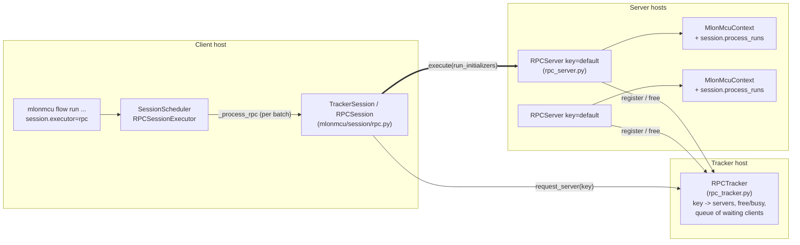
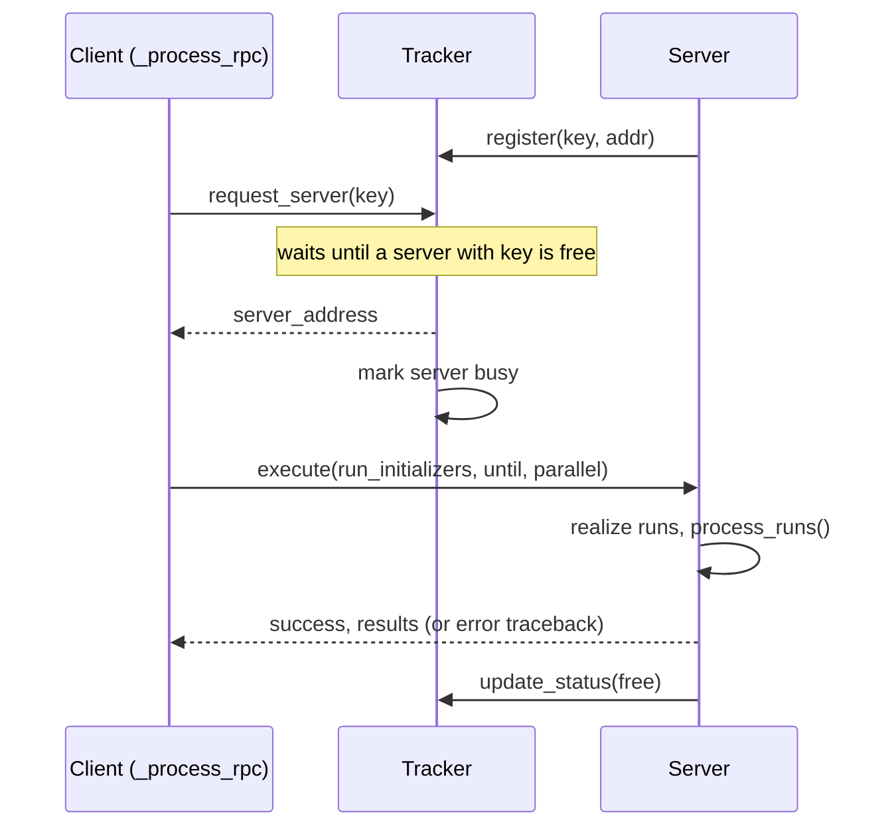

# Remote Execution (RPC)

MLonMCU can offload the processing of runs to other machines (e.g. a GPU/EDA server or a board farm).
The design is inspired by the TVM RPC tracker/server architecture.

> **Security:** requests contain pickled Python objects, i.e. anyone who can reach a server or tracker can execute
> arbitrary code. Only run them inside trusted networks (VPN, SSH tunnel, firewall).

## Architecture



* **Tracker** – knows which servers exist (per *key*) and whether they are free. Blocks clients until a server is free.
* **Server** – executes one session at a time on its own MLonMCU environment (`MLONMCU_HOME`) and tells the tracker when it is free again.
* **Client** – the normal `mlonmcu` CLI with `session.executor=rpc`. Runs are serialized as `RunInitializer`s
  (cloudpickle), results come back as pickled `RunResult`s.

## Sequence of one batch



Server state machine in the tracker: `registered(free) -> busy (handed out) -> free (server reports) `; `unregister` removes it.

## Usage

```
# 1. on the tracker host
python -m mlonmcu.session.rpc_tracker --port 9000

# 2. on each server host (with a working MLonMCU environment, `source` it first)
python -m mlonmcu.session.rpc_server --tracker tracker-host:9000 --key default --port 9001 --advertise-host $(hostname -f)

# 3. on the client
mlonmcu flow run aww --target etiss --backend tvmaot --platform mlif \
    -c session.executor=rpc -c session.rpc_tracker=tracker-host:9000 -c session.rpc_key=default \
    -c session.batch_size=4 -c session.parallel_jobs=4
```

Show the tracker state (servers, free/busy, queued requests); pass an interval in seconds to refresh periodically:

```
python -m mlonmcu.session.rpc_query tracker-host:9000 [interval]
```

The server accepts `--log-level` (default `INFO`) for the sessions it runs. Note that port 9000 may already be used
(e.g. by a TVM RPC tracker); pick another one with `--port`.

Requires the `cloudpickle` package on the client and all servers (part of `requirements.txt`).
The model/input files and the environment layout must be identical (or at least compatible) on client and servers:
there is currently no file transfer.

## Wire protocol

Length-prefixed JSON (`<i` int32 little endian size + UTF-8 JSON), see `mlonmcu/session/rpc_utils.py`.
Tracker actions: `register`, `unregister`, `request_server`, `update_status`, `summary` (same format as the original
`query_tracker.py`, which works unchanged). The tracker pings servers (`{"message": "ping"}` -> `{"message": "pong"}`
on the server's main port) and drops them after repeated failures.
Server operation: `execute` -> `{"success": bool, "results": [...], "error": str?}`.

## Artifacts

By default (`session.rpc_artifacts=none`) the run directories (build products, ELFs, logs, `artifacts.yml`, ...) stay
on the server and are discarded together with its temporary session; only the results/report come back.

With `-c session.rpc_artifacts=all` each batch is packed into a tar archive on the server, streamed back as raw
bytes after the JSON reply (announced via `artifacts_size`, no size limit, nothing held in memory) and unpacked into
the local session directory as `runs/<run idx>/`. The archive is validated on the client (no path traversal, links
must stay inside the run directory, only files and directories are extracted). Note that absolute paths recorded
inside transferred files (e.g. `artifacts.yml`) still refer to the server.

## Postprocesses

* *Run postprocesses* (`RunPostprocess`) are executed on the server as part of each run.
* *Session postprocesses* (`SessionPostprocess`, e.g. `bytes2kb`, `rename_cols`, `compare_rows`) operate on the merged
  report. The server strips them from the run initializers, and the client applies them to the merged report after
  all batches returned (`_postprocess_pickable`). They therefore only see the merged report, not the run artifacts, so
  session postprocesses which need run artifacts of the runs do not work remotely yet (the artifacts are available in
  the run directories if `session.rpc_artifacts=all` is used, but are not passed to the postprocesses).
* The `Run` column of the report is the session-wide index (it is restored on the client, as every batch is
  numbered from 0 on the server).

## Testing

`tests/unit-tests/session/test_rpc.py` tests the client with mocks; `tests/unit-tests/session/test_rpc_e2e.py`
starts a real tracker and servers on loopback with a stubbed execution function (queueing, key matching, error
propagation, recovery, liveness checks).
`tests/integration-tests/rpc/test_rpc_flow.py` (slow, needs `MLONMCU_HOME`) runs real `host_x86`/`tflmi` flows over a
local tracker and server and compares them to local runs, including batches and session postprocesses.

## Benchmarks

`python scripts/bench_rpc.py` measures (1) the pure transport overhead against a no-op server and (2) wall times of
real flows with `process_pool` vs. `rpc` (needs `MLONMCU_HOME`).

Results (loopback, 1 server, `toycar`, `host_x86`/`tflmi`, 4 parallel jobs; one repeat, so differences of a few seconds
are noise; wall time includes CLI startup and the flow itself):

| Transport (no-op server) | median |
|---|---|
| 1 initializer | 3.4 ms |
| 10 / 100 / 1000 initializers | 5.4 / 19 / 76 ms |

| runs | `process_pool` | `rpc`, 1 batch (`batch_size=runs`) | `rpc`, `batch_size=1` (1 server, serial) |
|---|---|---|---|
| 4 | 79 s | 77 s | 105 s |
| 8 | 153 s | 150 s | 200 s |

Conclusions: the protocol overhead (ms per batch) is negligible compared to a run (tens of seconds). Use large batches:
a batch executes in parallel on the server (`session.parallel_jobs`), while with `batch_size=1` the client sends runs
one by one and a single server processes them sequentially. To scale, start several servers with the same key and use
`batch_size` ~ runs / servers.

## Known limitations / roadmap

See the task list below; none of these are implemented yet unless marked done.

| # | Task | Priority |
|---|------|----------|
| 1 | Run a real end-to-end session (tracker + server + client, real `RunInitializer`, e.g. `tflmi`/`etiss`) in CI (integration test, marked slow) and verify the `session.results` returned by `_process_context` unpickle/report correctly | high |
| 2 | Authentication/encryption (shared secret handshake or TLS); replace pickle where possible | high |
| 3 | File transfer: artifacts back to the client is done (`session.rpc_artifacts`); still open: uploading models/inputs to the server, passing artifacts to session postprocesses, selecting which artifacts to fetch; `RPCSession.upload/download/...` are `NotImplementedError` | high |
| 4 | Server liveness pings are done (tracker drops dead servers); still open: handle server crash mid-session (client retry on another server), servers re-registering after a tracker restart | high |
| 5 | Client timeouts for `execute` (currently blocks forever) and `session_timeout`/`priority` are unused | medium |
| 6 | Allow server to pick `MLONMCU_HOME`/context and to run several sessions concurrently (`--max-sessions`) | medium |
| 7 | Session postprocesses needing run artifacts (needs task 3, passing transferred artifacts) | medium |
| 8 | Magic header handshake for tracker/server (commented TODO in `TrackerSession._connect`), protocol versioning, MLonMCU version check | medium |
| 9 | CLI entry points (`mlonmcu remote tracker/server`), systemd/Docker examples, `summary` CLI | medium |
| 10 | Logging with run/session ids across hosts | low |
| 11 | Replace `pip` optional dependency note by a proper extra (`pip install mlonmcu[remote]`) | low |

## Provenance

The client side was added in PR #220 (`mlonmcu/session/rpc.py`, `schedule.py`). The original tracker/server prototype
is the student project `mlonmcu_ghassen_hnaien_rpc_interface_demo` (GitLab, branches `main`, `philippvk`,
`fix_tracker_bugs`, `5-tracker-should-automatically-unregister-...`); it was never part of this repository.
`rpc_tracker.py` and `rpc_server.py` are a cleaned-up re-implementation of the same protocol, with these differences:

* the tracker is a thread-safe class with a condition variable (no global dicts, no busy queue handling in
  `update_status`) and can be started programmatically (used by the tests);
* the server frees itself after every session, instead of relying on the client's `update_status`, and handles
  pings on its main port (the prototype used `port + 1` and hardcoded tracker port 9000 for registration);
* errors on the server are returned to the client as a traceback instead of killing the connection thread.

Note: an old prototype server combined with the new client never becomes free again (the client no longer sends
`update_status`), so use the new server.
